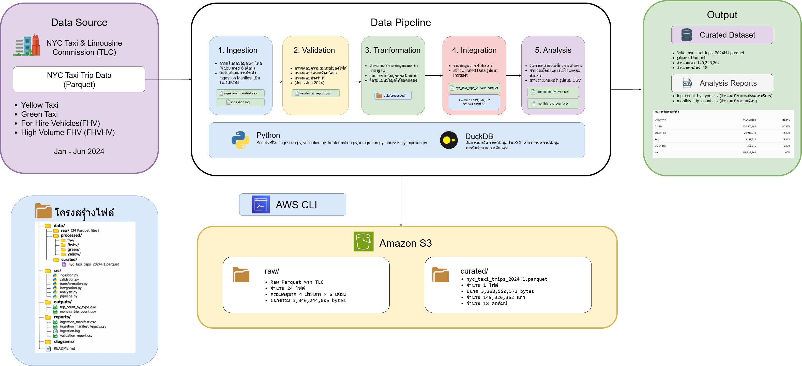

# NYC Taxi Reproducible Data Pipeline

**รายวิชา CS341 – Data Engineering**  
**Submission 2: Reproducible Data Pipeline**

## 1. ภาพรวมโครงงาน (Project Overview)

โครงงานนี้เป็นการพัฒนาต่อยอดจากโครงงาน NYC Taxi Data Lifecycle ใน Submission 1 โดยนำกระบวนการจัดการข้อมูลมาพัฒนาเป็น Data Pipeline ที่สามารถทำงานซ้ำได้อย่างเป็นระบบ (Reproducible Data Pipeline)

โครงงานใช้ข้อมูลการเดินทางของรถแท็กซี่ในนิวยอร์ก (NYC Taxi Trip Data) ตั้งแต่เดือนมกราคมถึงมิถุนายน ค.ศ. 2024 ครอบคลุมบริการรถโดยสาร 4 ประเภท ได้แก่

- Yellow Taxi
- Green Taxi
- For-Hire Vehicles (FHV)
- High Volume For-Hire Vehicles (FHVHV)

ระบบแบ่งการทำงานออกเป็น 5 ขั้นตอนหลัก ดังนี้

1. **Ingestion (การนำเข้าข้อมูล)** – ดาวน์โหลดไฟล์ข้อมูลดิบในรูปแบบ Parquet และบันทึกข้อมูลการนำเข้าไว้ใน Ingestion Manifest
2. **Validation (การตรวจสอบข้อมูล)** – ตรวจสอบความสามารถในการอ่านไฟล์ โครงสร้าง Schema และขอบเขตช่วงวันที่ของข้อมูล
3. **Transformation (การแปลงข้อมูล)** – ทำความสะอาดและปรับมาตรฐานข้อมูล รวมถึงใช้กฎการตรวจสอบคุณภาพข้อมูล
4. **Integration (การรวมข้อมูล)** – รวมข้อมูลที่ผ่านการประมวลผลจากบริการรถทั้ง 4 ประเภทให้เป็นชุดข้อมูล Curated Dataset เดียว
5. **Analysis (การวิเคราะห์ข้อมูล)** – วิเคราะห์ปริมาณการใช้บริการรถแต่ละประเภทและสร้างรายงานในรูปแบบ CSV

โครงงานพัฒนาด้วยภาษา Python และใช้ DuckDB สำหรับประมวลผลและวิเคราะห์ข้อมูล โดยจัดเก็บข้อมูล Raw Dataset และ Curated Dataset ไว้บน Amazon S3

## 2. คำถามวิจัย (Research Question)

**บริการรถแท็กซี่ประเภทใดมีจำนวนเที่ยวการเดินทางมากที่สุดในช่วงครึ่งแรกของปี 2024 (มกราคม–มิถุนายน)?**

การวิเคราะห์จะเปรียบเทียบจำนวนเที่ยวการเดินทางทั้งหมดของบริการทั้ง 4 ประเภท ได้แก่ Yellow Taxi, Green Taxi, FHV และ FHVHV รวมถึงวิเคราะห์จำนวนเที่ยวการเดินทางในแต่ละเดือน เพื่อศึกษารูปแบบการใช้บริการตลอดช่วงเวลาที่กำหนด


## 3. สถาปัตยกรรมระบบ (System Architecture)

ระบบถูกออกแบบให้ทำงานเป็นลำดับขั้นตอน ตั้งแต่การนำเข้าข้อมูลดิบจนถึงการวิเคราะห์และสร้างรายงาน โดยใช้ Python เป็นเครื่องมือหลักในการควบคุมการทำงานของ Pipeline และใช้ DuckDB สำหรับประมวลผลข้อมูลในรูปแบบ Parquet




### 3.1 องค์ประกอบของระบบ

- **Data Source:** ข้อมูล NYC Taxi Trip Data จากเว็บไซต์ NYC Taxi & Limousine Commission (TLC)
- **Local Data Storage:** จัดเก็บข้อมูล Raw Dataset และ Processed Dataset ในเครื่องระหว่างการประมวลผล
- **Processing Engine:** Python ใช้ควบคุมลำดับการทำงานของ Pipeline และ DuckDB ใช้ตรวจสอบ แปลง รวม และวิเคราะห์ข้อมูล
- **Curated Dataset:** ชุดข้อมูลที่ผ่านการประมวลผลและรวมข้อมูลจากรถทั้ง 4 ประเภทไว้ในไฟล์ Parquet เดียว
- **Output Reports:** รายงานผลการวิเคราะห์ในรูปแบบ CSV
- **Cloud Storage:** Amazon S3 ใช้จัดเก็บ Raw Dataset และ Curated Dataset เพื่อสำรองและเข้าถึงข้อมูลผ่าน Cloud Storage

### 3.2 ลำดับการทำงานของระบบ

Pipeline ทำงานตามลำดับ 5 ขั้นตอน ได้แก่ Ingestion, Validation, Transformation, Integration และ Analysis โดยแต่ละขั้นตอนใช้ผลลัพธ์จากขั้นตอนก่อนหน้าเป็นข้อมูลนำเข้า

ข้อมูลดิบที่ดาวน์โหลดจาก TLC จะถูกจัดเก็บไว้ใน Local Storage ก่อนเข้าสู่กระบวนการตรวจสอบและแปลงข้อมูล จากนั้นจึงรวมเป็น Curated Dataset และนำไปวิเคราะห์เพื่อสร้างรายงาน

นอกจากนี้ Raw Dataset และ Curated Dataset ยังถูกจัดเก็บไว้บน Amazon S3 แยกตามโฟลเดอร์ `raw/` และ `curated/` โดยใช้ AWS CLI ในการอัปโหลดข้อมูล

## 4. โครงสร้างโปรเจกต์ (Project Structure)

โปรเจกต์แบ่งโฟลเดอร์ตามหน้าที่ของแต่ละส่วน เพื่อให้ง่ายต่อการพัฒนา ตรวจสอบ และเรียกใช้งาน Pipeline

```text
nyc-taxi-reproducible-pipeline/
│
├── data/
│   ├── raw/                 # ข้อมูลดิบจาก TLC
│   ├── processed/           # ข้อมูลหลัง Transformation
│   └── curated/             # Curated Dataset
│
├── src/
│   ├── ingestion.py         # ดาวน์โหลดข้อมูล
│   ├── validation.py        # ตรวจสอบคุณภาพข้อมูล
│   ├── transformation.py    # ทำความสะอาดและแปลงข้อมูล
│   ├── integration.py       # รวมข้อมูลจากทั้ง 4 ประเภท
│   ├── analysis.py          # วิเคราะห์ข้อมูล
│   └── pipeline.py          # ควบคุมการทำงานทั้งหมด
│
├── outputs/
│   ├── trip_count_by_type.csv
│   └── monthly_trip_count.csv
│
├── reports/
│   ├── ingestion_manifest.csv
│   ├── ingestion_manifest_legacy.csv
│   └── validation_report.csv
│
├── diagrams/
│   └── pipeline_architecture.png
│
├── sample/
│   └── curated_sample.csv
│
├── requirements.txt
└── README.md
```

หมายเหตุ: โฟลเดอร์ `data/` ใช้จัดเก็บข้อมูลระหว่างการประมวลผล ซึ่งไม่ได้รวมไฟล์ Parquet ขนาดใหญ่ไว้ใน GitHub โดยมีไฟล์ `sample/curated_sample.csv` สำหรับแสดงตัวอย่างข้อมูล Curated Dataset

## 5. การติดตั้งและเรียกใช้งาน (Installation and Execution)

Pipeline ถูกออกแบบให้สามารถทำงานซ้ำได้ โดยใช้ข้อมูลจาก NYC TLC เป็นแหล่งข้อมูลหลัก ผู้ใช้งานสามารถ Clone Repository และเรียกใช้ Pipeline ได้โดยไม่จำเป็นต้องมี AWS Credentials

### 5.1 Prerequisites

เครื่องที่ใช้ควรมีโปรแกรมดังต่อไปนี้

- Python 3.11
- Git
- Internet connection สำหรับดาวน์โหลดข้อมูลจาก NYC TLC

### 5.2 Clone Repository

เปิด Terminal แล้วใช้คำสั่ง

```bash
git clone https://github.com/natcha6709650011/nyc-taxi-reproducible-pipeline.git
```

เข้าสู่โฟลเดอร์โปรเจกต์

```bash
cd nyc-taxi-reproducible-pipeline
```

### 5.3 Install Dependencies

แนะนำให้สร้าง Virtual Environment ก่อนติดตั้งไลบรารี

สำหรับ Windows:

```bash
python -m venv .venv
source .venv/Scripts/activate
```

ติดตั้ง Dependencies ด้วยคำสั่ง

```bash
pip install -r requirements.txt
```

โปรเจกต์ใช้ DuckDB สำหรับการประมวลผลข้อมูล โดยกำหนดเวอร์ชันไว้ใน `requirements.txt`

### 5.4 Run the Pipeline

เมื่อเตรียมสภาพแวดล้อมเรียบร้อยแล้ว สามารถเรียกใช้งาน Pipeline ทั้ง 5 ขั้นตอนด้วยคำสั่ง

```bash
python src/pipeline.py
```

ระบบจะดำเนินการตามลำดับดังนี้

1. ดาวน์โหลดข้อมูลดิบจาก NYC TLC
2. ตรวจสอบความถูกต้องและโครงสร้างของข้อมูล
3. ทำความสะอาดและแปลงข้อมูล
4. รวมข้อมูลเป็น Curated Dataset
5. วิเคราะห์ข้อมูลและสร้างรายงาน CSV

หากขั้นตอนใดล้มเหลว Pipeline จะหยุดการทำงานและแสดง Error Log เพื่อช่วยตรวจสอบปัญหา

### 5.5 Output Files

เมื่อ Pipeline ทำงานสำเร็จ จะได้ไฟล์ผลลัพธ์หลักดังนี้

| ไฟล์ | รายละเอียด |
|---|---|
| `data/curated/nyc_taxi_trips_2024H1.parquet` | Curated Dataset |
| `outputs/trip_count_by_type.csv` | จำนวนเที่ยวเดินทางแยกตามประเภทรถ |
| `outputs/monthly_trip_count.csv` | จำนวนเที่ยวเดินทางแยกตามเดือนและประเภทรถ |
| `reports/ingestion_manifest.csv` | บันทึกสถานะการนำเข้าข้อมูล |
| `reports/validation_report.csv` | รายงานผลการตรวจสอบข้อมูล |

ผู้ใช้งานสามารถเปิด `sample/curated_sample.csv` เพื่อดูตัวอย่างข้อมูลได้โดยไม่ต้องประมวลผล Dataset ทั้งหมด

**หมายเหตุ:** การรัน Pipeline ต้องเชื่อมต่ออินเทอร์เน็ตเพื่อดาวน์โหลดข้อมูลจาก TLC และต้องมีพื้นที่จัดเก็บข้อมูลเพียงพอสำหรับไฟล์ Raw, Processed และ Curated Dataset ส่วน Amazon S3 ใช้สำหรับจัดเก็บสำเนาข้อมูลที่อัปโหลดไว้ ไม่ใช่แหล่งข้อมูลที่ Pipeline ต้องเชื่อมต่อเพื่อทำงาน

## 6. ผลการตรวจสอบคุณภาพข้อมูล (Data Quality and Validation Results)

หลังจากนำเข้าข้อมูลดิบจาก NYC TLC ระบบจะดำเนินการตรวจสอบคุณภาพข้อมูลก่อนเข้าสู่ขั้นตอน Transformation โดยใช้ DuckDB ในการอ่านและตรวจสอบไฟล์ Parquet

### 6.1 Validation Checks

ระบบตรวจสอบข้อมูลในประเด็นหลักดังนี้

- **File Readability:** ตรวจสอบว่าไฟล์ Parquet สามารถอ่านได้และมีข้อมูลอยู่ภายใน
- **Schema Validation:** ตรวจสอบว่าข้อมูลมีคอลัมน์ที่จำเป็นตามประเภทของบริการรถ
- **Date Scope:** ตรวจสอบช่วงวันที่ของข้อมูลให้อยู่ในขอบเขตการศึกษาเดือนมกราคมถึงมิถุนายน 2024
- **Null Pickup Datetime:** ตรวจสอบรายการที่ไม่มีค่า Pickup Datetime
- **File Count:** ตรวจสอบจำนวนไฟล์ข้อมูลที่นำเข้าให้ครบ 24 ไฟล์

### 6.2 Validation Results

ผลการตรวจสอบข้อมูลดิบพบว่า

| รายการตรวจสอบ | ผลลัพธ์ |
|---|---:|
| จำนวนไฟล์ทั้งหมด | 24 |
| ไฟล์ที่ผ่าน Validation | 24 |
| ไฟล์ที่ไม่ผ่าน Validation | 0 |
| Null Pickup Datetime | 0 |
| จำนวนไฟล์ตามที่คาดหวัง | 24/24 |

นอกจากนี้ยังพบข้อมูลบางรายการที่มีวันที่อยู่นอกช่วงการศึกษาและข้อมูลการเดินทางที่ข้ามเดือน ซึ่งระบบบันทึกสถานะไว้เพื่อใช้ประกอบการพิจารณาในขั้นตอนถัดไป โดยไม่ได้ถือว่าทุกรายการดังกล่าวเป็นไฟล์ที่ไม่ผ่าน Validation

### 6.3 Data Quality Findings

จากการตรวจสอบพบว่า

- มีข้อมูลจำนวน 193 รายการที่มีวันที่อยู่นอกเดือนที่ระบุในไฟล์ต้นทาง
- มีข้อมูลจำนวน 45 รายการที่มี Pickup Datetime อยู่นอกช่วงการศึกษา มกราคม–มิถุนายน 2024
- ไม่พบรายการที่มี Null Pickup Datetime

ข้อมูลที่อยู่นอกช่วงการศึกษาจะถูกจัดการในขั้นตอน Transformation เพื่อให้ Curated Dataset มีขอบเขตตรงตาม Research Question

## 7. ผลการแปลงและรวมข้อมูล (Transformation and Integration Results)

### 7.1 Transformation

ในขั้นตอน Transformation ระบบดำเนินการดังนี้

- ปรับมาตรฐานชื่อคอลัมน์ของข้อมูลจากบริการรถแต่ละประเภท
- เพิ่มคอลัมน์ `service_type`, `source_file` และ `source_file_month`
- ตรวจสอบค่าติดลบในคอลัมน์ที่กำหนดตามประเภทของบริการรถ และคัดกรองรายการที่มีค่าติดลบออก
- กำหนดช่วงข้อมูลโดยใช้ Pickup Datetime ตั้งแต่วันที่ 1 มกราคม 2024 ถึงก่อนวันที่ 1 กรกฎาคม 2024
- สร้าง Flag สำหรับระบุรายการเดินทางข้ามเดือน (`is_cross_month_trip`)
- สร้าง Flag สำหรับระบุระยะเวลาการเดินทางที่ไม่ถูกต้อง (`is_invalid_duration`)
- สร้าง Flag สำหรับระบุรายการเดินทางข้ามเดือนที่มีระยะเวลามากกว่า 24 ชั่วโมง (`is_suspicious_cross_month`)

ระบบเก็บค่า 0 และ NULL ไว้ ไม่ได้ถือว่าเป็นค่าติดลบ ส่วนรายการที่มีระยะเวลาเดินทางผิดปกติหรือมีลักษณะน่าสงสัยจะถูกทำเครื่องหมายไว้เพื่อการตรวจสอบ ไม่ได้ถูกลบออกโดยอัตโนมัติ

### 7.2 Transformation Results

ผลการประมวลผลข้อมูลก่อนและหลัง Transformation มีดังนี้

| Taxi Type | Before | After | Removed |
|---|---:|---:|---:|
| Yellow Taxi | 20,332,093 | 20,015,271 | 316,822 |
| Green Taxi | 339,807 | 338,615 | 1,192 |
| FHV | 8,119,228 | 8,119,228 | 0 |
| FHVHV | 120,864,668 | 120,853,248 | 11,420 |
| **Total** | **149,655,796** | **149,326,362** | **329,434** |

หลัง Transformation ระบบตรวจสอบเพิ่มเติมและพบว่า

- ไม่พบ Null Pickup Datetime ในข้อมูลที่ผ่านการประมวลผล
- ไม่พบข้อมูลที่มี Pickup Datetime อยู่นอกช่วงการศึกษา
- ไม่พบค่าติดลบในคอลัมน์ที่กำหนดกฎการตรวจสอบ
- พบรายการที่มี Invalid Duration จำนวน 300 รายการ
- พบรายการ Suspicious Cross-Month จำนวน 1,278 รายการ

รายการที่ถูกทำเครื่องหมายว่า Invalid Duration และ Suspicious Cross-Month ยังคงอยู่ในชุดข้อมูล โดยใช้ Flag เพื่อระบุลักษณะข้อมูลดังกล่าว

### 7.3 Integration Results

หลังจาก Transformation ระบบนำข้อมูลจากบริการรถทั้ง 4 ประเภทมารวมเป็น Curated Dataset โดยใช้ DuckDB และจัดเก็บในรูปแบบ Parquet พร้อมการบีบอัด ZSTD

ผลการรวมข้อมูล:

| รายการ | จำนวน |
|---|---:|
| จำนวนไฟล์ Processed | 24 |
| จำนวนแถวจาก Processed Dataset | 149,326,362 |
| จำนวนแถวใน Curated Dataset | 149,326,362 |
| จำนวนคอลัมน์ | 18 |

ระบบตรวจสอบจำนวนแถวก่อนและหลัง Integration เพื่อยืนยันว่าการรวมข้อมูลไม่ทำให้จำนวนรายการเดินทางสูญหาย

ไฟล์ผลลัพธ์คือ `data/curated/nyc_taxi_trips_2024H1.parquet` ซึ่งเป็น Curated Dataset แบบไฟล์เดียว ไม่ได้แบ่งเป็น Partition ตามเดือน

## 8. ผลการวิเคราะห์ข้อมูล (Analysis Results)

หลังจากรวมข้อมูลเป็น Curated Dataset แล้ว ระบบจะนำข้อมูลมาวิเคราะห์เพื่อตอบคำถามวิจัยว่า บริการรถประเภทใดมีจำนวนเที่ยวการเดินทางมากที่สุดในช่วงครึ่งแรกของปี 2024

### 8.1 Trip Count by Taxi Type

ระบบคำนวณจำนวนเที่ยวการเดินทางและสัดส่วนของบริการรถแต่ละประเภทจาก Curated Dataset โดยมีผลลัพธ์ดังนี้

| Taxi Type | Number of Trips | Percentage |
|---|---:|---:|
| FHVHV | 120,853,248 | 80.93% |
| Yellow Taxi | 20,015,271 | 13.40% |
| FHV | 8,119,228 | 5.44% |
| Green Taxi | 338,615 | 0.23% |
| **Total** | **149,326,362** | **100%** |

จากผลการวิเคราะห์พบว่า FHVHV เป็นบริการที่มีจำนวนเที่ยวการเดินทางมากที่สุด โดยคิดเป็น 80.93% ของเที่ยวการเดินทางทั้งหมด รองลงมาคือ Yellow Taxi, FHV และ Green Taxi ตามลำดับ

### 8.2 Monthly Trip Analysis

นอกจากการเปรียบเทียบจำนวนเที่ยวการเดินทางทั้งหมดแล้ว ระบบยังวิเคราะห์จำนวนเที่ยวแยกตามเดือนและประเภทรถ เพื่อศึกษารูปแบบการใช้บริการในช่วงเดือนมกราคมถึงมิถุนายน 2024

ผลการวิเคราะห์ถูกจัดเก็บไว้ในไฟล์ `outputs/monthly_trip_count.csv` โดยมีข้อมูลจำนวนเที่ยวเดินทางแยกตามเดือนและประเภทรถ รวมทั้งหมด 24 กลุ่มข้อมูล (4 ประเภทรถ × 6 เดือน)

### 8.3 Analysis Outputs

ระบบสร้างไฟล์ผลลัพธ์สำหรับนำไปใช้งานต่อจำนวน 2 ไฟล์ ได้แก่

- `outputs/trip_count_by_type.csv` – จำนวนเที่ยวเดินทางและสัดส่วนของบริการรถแต่ละประเภท
- `outputs/monthly_trip_count.csv` – จำนวนเที่ยวเดินทางแยกตามเดือนและประเภทรถ

### 8.4 Research Question Conclusion

จากผลการวิเคราะห์ข้อมูลการเดินทางในช่วงเดือนมกราคมถึงมิถุนายน 2024 พบว่า **FHVHV (High Volume For-Hire Vehicles) เป็นบริการที่มีจำนวนเที่ยวการเดินทางมากที่สุด** โดยมีจำนวน 120,853,248 เที่ยว หรือคิดเป็น 80.93% ของข้อมูลทั้งหมดที่ผ่านกระบวนการ Transformation และ Integration

## 9. การตัดสินใจในการออกแบบ (Design Decisions)

ระหว่างการพัฒนา Pipeline มีการตัดสินใจด้านการออกแบบหลายประการ เพื่อให้การประมวลผลข้อมูลมีความเหมาะสมและลดการสูญเสียข้อมูลที่อาจยังมีประโยชน์ต่อการวิเคราะห์

### 9.1 การเลือกใช้ Pickup Datetime เป็นเกณฑ์กำหนดช่วงข้อมูล

โครงงานกำหนดช่วงการศึกษาตั้งแต่วันที่ 1 มกราคม 2024 ถึงก่อนวันที่ 1 กรกฎาคม 2024 โดยใช้ Pickup Datetime เป็นเกณฑ์ในการคัดเลือกข้อมูล เนื่องจากต้องการให้การนับเที่ยวเดินทางอ้างอิงจากวันที่เริ่มต้นการเดินทางอย่างสม่ำเสมอ แม้ว่าการเดินทางบางรายการจะสิ้นสุดในเดือนถัดไปก็ตาม

### 9.2 การเก็บค่า 0 และ NULL ไว้ในข้อมูล

ระบบเลือกคัดกรองค่าติดลบเฉพาะคอลัมน์ที่กำหนดตามประเภทของบริการรถ โดยไม่ลบค่า 0 และ NULL ออกโดยอัตโนมัติ เนื่องจากค่าเหล่านี้ไม่ได้หมายความว่าเป็นข้อมูลผิดปกติเสมอไป การเก็บข้อมูลดังกล่าวไว้ช่วยลดการสูญเสียข้อมูลที่อาจมีความหมายต่อการวิเคราะห์

### 9.3 การใช้ Flag ระบุข้อมูลผิดปกติแทนการลบทั้งหมด

รายการที่มีระยะเวลาเดินทางไม่ถูกต้องหรือมีลักษณะน่าสงสัย เช่น การเดินทางข้ามเดือนที่ใช้เวลามากกว่า 24 ชั่วโมง จะถูกเพิ่ม Flag เพื่อระบุสถานะ แทนการลบออกโดยอัตโนมัติ วิธีนี้ช่วยรักษาข้อมูลต้นทางไว้และเปิดโอกาสให้ตรวจสอบเพิ่มเติมในภายหลัง

### 9.4 การใช้ Parquet และ DuckDB

ระบบเลือกใช้ Parquet ร่วมกับการบีบอัด ZSTD สำหรับจัดเก็บข้อมูลที่ผ่านการประมวลผล เนื่องจากเหมาะกับการจัดเก็บข้อมูลเชิงตารางขนาดใหญ่ และใช้ DuckDB เพื่อประมวลผลและวิเคราะห์ข้อมูลโดยไม่จำเป็นต้องโหลดข้อมูลทั้งหมดเข้าสู่หน่วยความจำ

## 10. ข้อจำกัดของระบบ (Limitations)

โครงงานมีข้อจำกัดบางประการที่ควรพิจารณาในการนำ Pipeline ไปใช้งาน ได้แก่

- **Source Dependency:** Pipeline ต้องเชื่อมต่ออินเทอร์เน็ตและอาศัยความพร้อมใช้งานของข้อมูลจาก NYC TLC หากแหล่งข้อมูลไม่พร้อมใช้งานจะไม่สามารถดาวน์โหลดไฟล์ใหม่ได้
- **Storage Requirement:** ข้อมูล Raw, Processed และ Curated มีขนาดใหญ่ ผู้ใช้งานจึงต้องเตรียมพื้นที่จัดเก็บข้อมูลให้เพียงพอ
- **Local Processing:** กระบวนการหลักทำงานบนเครื่องผู้ใช้งาน ไม่ได้ประมวลผลผ่านระบบ Cloud โดยตรง
- **Data Anomalies:** รายการที่มี Invalid Duration และ Suspicious Cross-Month ถูกทำเครื่องหมายไว้ แต่ยังคงอยู่ใน Curated Dataset จึงควรพิจารณาก่อนนำข้อมูลเหล่านี้ไปใช้ในการวิเคราะห์เฉพาะด้าน
- **Cloud Storage Access:** ข้อมูล Raw Dataset และ Curated Dataset ถูกจัดเก็บบน Amazon S3 โดยเปิดสิทธิ์ Public Read เฉพาะไฟล์ภายในโฟลเดอร์ `raw/` และ `curated/` ผู้ใช้งานสามารถดาวน์โหลดข้อมูลได้โดยไม่ต้องใช้ AWS Credentials โดยไม่มีสิทธิ์อัปโหลดหรือลบไฟล์

## 11. สิ่งที่ได้เรียนรู้ (Learning Reflection)

จากการทำโปรเจกต์นี้ทำให้เข้าใจการทำ Data Pipeline มากขึ้น เพราะได้ลองทำตั้งแต่การดาวน์โหลดข้อมูล ตรวจสอบข้อมูล ทำความสะอาด และนำข้อมูลมารวมกัน ตอนแรกการจัดการข้อมูลที่มีขนาดใหญ่ค่อนข้างยาก โดยเฉพาะตอนตรวจสอบและประมวลผลไฟล์ Parquet แต่พอได้ลองใช้ Python และ DuckDB ก็เข้าใจวิธีจัดการข้อมูลมากขึ้น นอกจากนี้ยังได้ฝึกใช้ AWS S3 และ GitHub ซึ่งสามารถนำไปใช้กับการทำโปรเจกต์อื่น ๆ ได้

## 12. การจัดเก็บและดาวน์โหลดข้อมูลผ่าน Amazon S3

โปรเจกต์นี้ใช้ Amazon S3 เป็นพื้นที่จัดเก็บสำเนาข้อมูลบน Cloud เพื่อให้ผู้ที่สนใจสามารถเข้าถึงและดาวน์โหลดชุดข้อมูลไปใช้งานได้ โดยไม่จำเป็นต้องมีบัญชี AWS หรือกำหนดค่า AWS Credentials

ข้อมูลที่จัดเก็บบน S3 แบ่งออกเป็น 2 ประเภท ได้แก่ Raw Dataset และ Curated Dataset

### 12.1 Raw Dataset (ข้อมูลดิบ)

Raw Dataset คือข้อมูลต้นฉบับที่ดาวน์โหลดมาจากเว็บไซต์ NYC Taxi and Limousine Commission (TLC) โดยยังไม่ผ่านกระบวนการทำความสะอาดหรือแปลงข้อมูล

ข้อมูลครอบคลุมช่วงเดือนมกราคมถึงมิถุนายน 2024 รวมทั้งหมด 24 ไฟล์ แบ่งตามประเภทของรถ 4 ประเภท ได้แก่

**1. Yellow Taxi (รถแท็กซี่สีเหลือง)**

- [January 2024](https://nyc-taxi-0011.s3.us-east-1.amazonaws.com/raw/yellow_tripdata_2024-01.parquet)
- [February 2024](https://nyc-taxi-0011.s3.us-east-1.amazonaws.com/raw/yellow_tripdata_2024-02.parquet)
- [March 2024](https://nyc-taxi-0011.s3.us-east-1.amazonaws.com/raw/yellow_tripdata_2024-03.parquet)
- [April 2024](https://nyc-taxi-0011.s3.us-east-1.amazonaws.com/raw/yellow_tripdata_2024-04.parquet)
- [May 2024](https://nyc-taxi-0011.s3.us-east-1.amazonaws.com/raw/yellow_tripdata_2024-05.parquet)
- [June 2024](https://nyc-taxi-0011.s3.us-east-1.amazonaws.com/raw/yellow_tripdata_2024-06.parquet)

**2. Green Taxi (รถแท็กซี่สีเขียว)**

- [January 2024](https://nyc-taxi-0011.s3.us-east-1.amazonaws.com/raw/green_tripdata_2024-01.parquet)
- [February 2024](https://nyc-taxi-0011.s3.us-east-1.amazonaws.com/raw/green_tripdata_2024-02.parquet)
- [March 2024](https://nyc-taxi-0011.s3.us-east-1.amazonaws.com/raw/green_tripdata_2024-03.parquet)
- [April 2024](https://nyc-taxi-0011.s3.us-east-1.amazonaws.com/raw/green_tripdata_2024-04.parquet)
- [May 2024](https://nyc-taxi-0011.s3.us-east-1.amazonaws.com/raw/green_tripdata_2024-05.parquet)
- [June 2024](https://nyc-taxi-0011.s3.us-east-1.amazonaws.com/raw/green_tripdata_2024-06.parquet)

**3. For-Hire Vehicle (FHV)**

- [January 2024](https://nyc-taxi-0011.s3.us-east-1.amazonaws.com/raw/fhv_tripdata_2024-01.parquet)
- [February 2024](https://nyc-taxi-0011.s3.us-east-1.amazonaws.com/raw/fhv_tripdata_2024-02.parquet)
- [March 2024](https://nyc-taxi-0011.s3.us-east-1.amazonaws.com/raw/fhv_tripdata_2024-03.parquet)
- [April 2024](https://nyc-taxi-0011.s3.us-east-1.amazonaws.com/raw/fhv_tripdata_2024-04.parquet)
- [May 2024](https://nyc-taxi-0011.s3.us-east-1.amazonaws.com/raw/fhv_tripdata_2024-05.parquet)
- [June 2024](https://nyc-taxi-0011.s3.us-east-1.amazonaws.com/raw/fhv_tripdata_2024-06.parquet)

**4. High-Volume For-Hire Vehicle (FHVHV)**

- [January 2024](https://nyc-taxi-0011.s3.us-east-1.amazonaws.com/raw/fhvhv_tripdata_2024-01.parquet)
- [February 2024](https://nyc-taxi-0011.s3.us-east-1.amazonaws.com/raw/fhvhv_tripdata_2024-02.parquet)
- [March 2024](https://nyc-taxi-0011.s3.us-east-1.amazonaws.com/raw/fhvhv_tripdata_2024-03.parquet)
- [April 2024](https://nyc-taxi-0011.s3.us-east-1.amazonaws.com/raw/fhvhv_tripdata_2024-04.parquet)
- [May 2024](https://nyc-taxi-0011.s3.us-east-1.amazonaws.com/raw/fhvhv_tripdata_2024-05.parquet)
- [June 2024](https://nyc-taxi-0011.s3.us-east-1.amazonaws.com/raw/fhvhv_tripdata_2024-06.parquet)

### 12.2 Curated Dataset (ข้อมูลที่ผ่านการประมวลผลแล้ว)

Curated Dataset คือข้อมูลที่ผ่านกระบวนการตรวจสอบคุณภาพ ทำความสะอาด แปลงรูปแบบ และรวมข้อมูลจากรถทั้ง 4 ประเภทเข้าด้วยกันแล้ว

ข้อมูลชุดนี้เป็นผลลัพธ์จากกระบวนการ Data Pipeline ของโปรเจกต์ สามารถนำไปใช้วิเคราะห์ต่อได้ทันทีโดยไม่ต้องประมวลผลข้อมูลดิบใหม่

**รายละเอียดชุดข้อมูล**

- ชื่อไฟล์: `nyc_taxi_trips_2024H1.parquet`
- จำนวนข้อมูล: 149,326,362 Records
- ขนาดไฟล์: ประมาณ 3.37 GB
- รูปแบบไฟล์: Parquet

[ดาวน์โหลด Curated Dataset](https://nyc-taxi-0011.s3.us-east-1.amazonaws.com/curated/nyc_taxi_trips_2024H1.parquet)

### 12.3 วิธีเข้าถึงและใช้งานข้อมูล

ผู้ที่สนใจสามารถคลิกลิงก์ของชุดข้อมูลที่ต้องการเพื่อดาวน์โหลดไฟล์ได้โดยตรง โดยไม่จำเป็นต้องใช้ AWS Credentials

- หากต้องการทดลองกระบวนการ Data Pipeline ตั้งแต่ต้น สามารถใช้ Raw Dataset หรือรัน Pipeline เพื่อดาวน์โหลดข้อมูลจากเว็บไซต์ TLC ได้
- หากต้องการนำข้อมูลที่ผ่านการประมวลผลแล้วไปวิเคราะห์ต่อ สามารถดาวน์โหลด Curated Dataset ได้ทันที

ไฟล์ทั้งหมดจัดเก็บในรูปแบบ Parquet ซึ่งสามารถนำไปใช้งานร่วมกับเครื่องมือวิเคราะห์ข้อมูล เช่น DuckDB และ Python ได้

**หมายเหตุ:** Amazon S3 ในโปรเจกต์นี้ใช้สำหรับจัดเก็บสำเนาข้อมูลบน Cloud และเป็นช่องทางให้ดาวน์โหลดข้อมูลเพิ่มเติม ส่วนการทำงานหลักของ Data Pipeline ยังคงดึงข้อมูลต้นทางจาก TLC และประมวลผลตามขั้นตอนที่กำหนดไว้ในโปรเจกต์ การดาวน์โหลดไฟล์ขนาดใหญ่จำเป็นต้องมีพื้นที่จัดเก็บและอินเทอร์เน็ตที่เพียงพอ